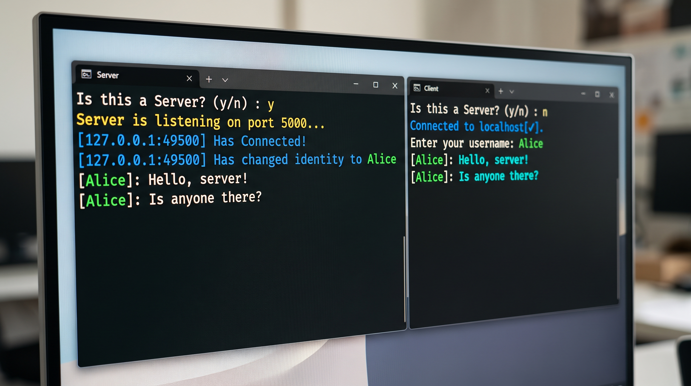

# 💬 Console Chat Application

An ultra-lightweight, high-performance, multi-client TCP terminal chat system built in Java 21+. It features real-time client identity switching, ANSI-formatted colored console logging, and virtual thread concurrency.

---

## 🌟 Visual Preview




---

## ⚡ Core Features

* ⚡ **Virtual Thread Architecture** — Powered by Java's Project Loom (`Executors.newVirtualThreadPerTaskExecutor()`), enabling lightweight client connection scaling without thread pool limits.
* 🎨 **ANSI Terminal Formatting** — Rich, color-coded logging for incoming connections, IP address resolution, and dynamic identity management.
* 🆔 **Dynamic Identity Tracking** — Clients set custom usernames upon connecting, which are attached to server logs.
* 🔄 **Dual-Mode Executable** — Unified launch system that prompts the user to run as a server or a client from a single binary.

---

## ⚙️ Tech Stack & Requirements

| Component | Specification |
| :--- | :--- |
| **Language** | Java 21 or higher |
| **Concurrency** | Project Loom (Virtual Threads) |
| **Networking** | Standard Java TCP Sockets (`ServerSocket`, `Socket`) |
| **Dependencies** | None (Zero external dependencies) |

---

## 📂 Project Structure

```text
├── assets/
│   └── terminal-preview.jpg   # Console preview image for GitHub
├── Main.java                  # Interactive binary entry point
├── ServerFile.java            # Multi-threaded TCP server handler
├── ClientFile.java            # Interactive TCP client connection loop
└── ConsoleColors.java         # Native ANSI color codes & formatting helpers
